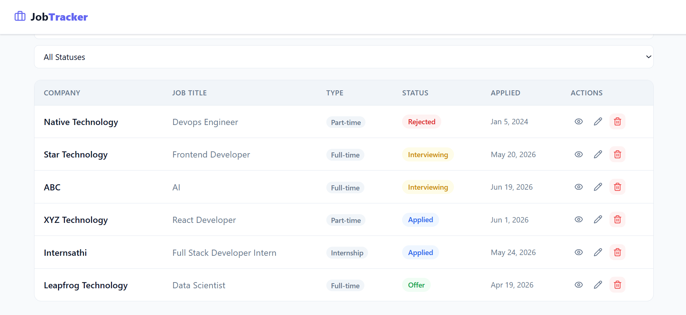
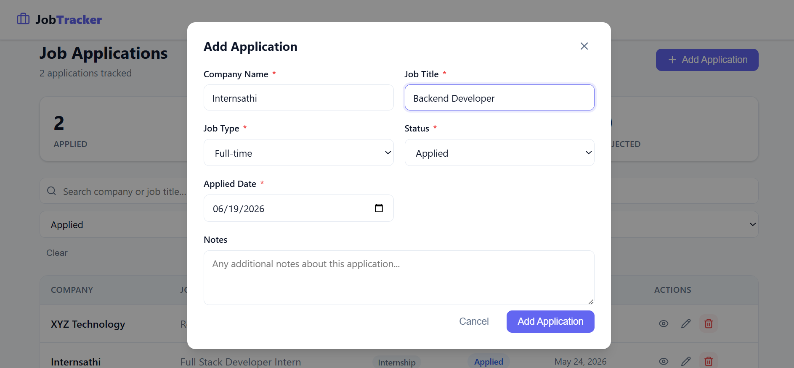
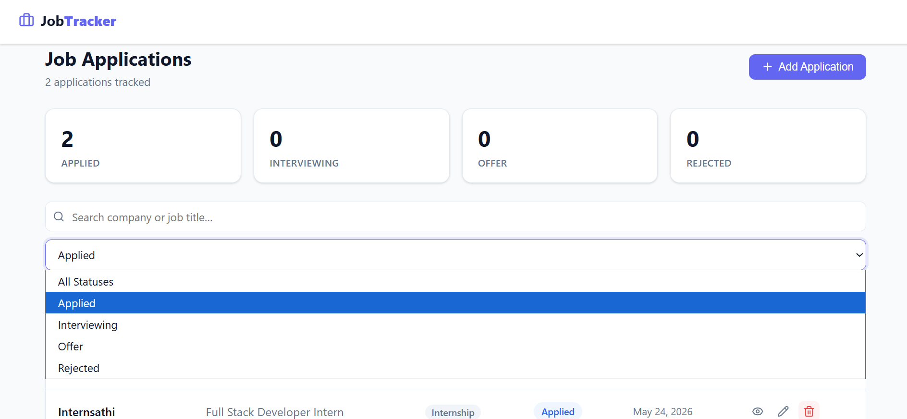
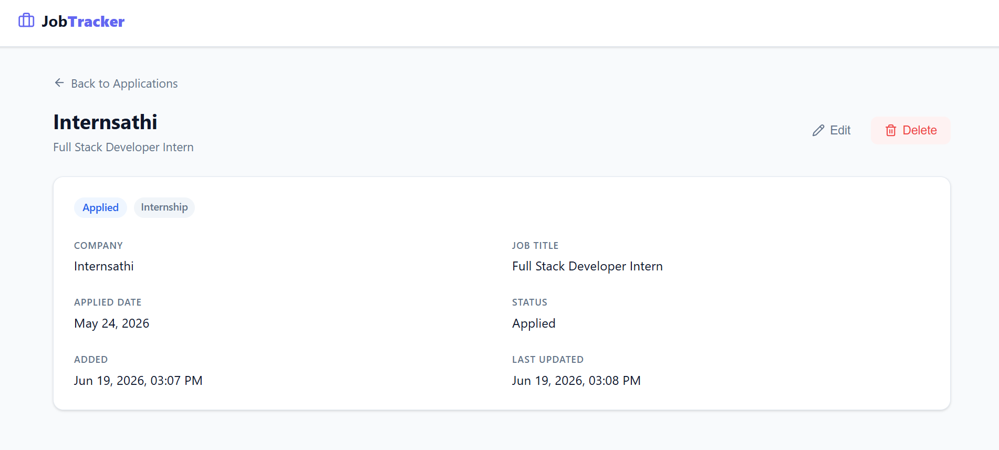

# JobTracker

A full-stack job application tracker for managing the hiring pipeline from application to offer.

## Demo

[Watch demo video](https://youtu.be/PT-s5vWKB1o)

## Screenshots









---

## Tech Stack

| Layer    | Technology                                  |
| -------- | ------------------------------------------- |
| Frontend | React 18, Vite, TypeScript, React Router v6 |
| Styling  | Vanilla CSS                                 |
| Forms    | React Hook Form, Zod                        |
| Backend  | Node.js 24, Express, TypeScript             |
| Database | PostgreSQL 16                               |
| API      | REST                                        |
| Testing  | Jest, ts-jest, Supertest                    |
| DevOps   | Docker, Docker Compose                      |

---

## Features

* Application list with pagination
* Add and edit job applications
* Form validation
* Delete confirmation
* Filter by application status
* Search by company name or job title
* Detailed application view
* Status statistics
* Loading states
* Toast notifications
* Database migrations
* REST API
* Unit tests

---

## Quick Start

### Using Docker

```bash
git clone https://github.com/sarinashakya/jobtracker.git
cd jobtracker
docker compose up --build
```

The application will be available at:

* Frontend: `http://localhost:3000`
* Backend API: `http://localhost:4000`
* PostgreSQL: `localhost:5432`

### Manual Setup

#### Backend

```bash
cd backend
cp .env.example .env
npm install
npm run migrate
npm run dev
```

#### Frontend

```bash
cd frontend
cp .env.example .env
npm install
npm run dev
```

---

## Testing

```bash
cd backend
npm test
```

The project includes automated tests for the REST API endpoints using Jest and Supertest.

---

## Project Structure

```text
jobtracker/
├── backend/
│   └── src/
│       ├── controllers/
│       ├── db/
│       ├── middleware/
│       ├── routes/
│       ├── types/
│       ├── app.ts
│       └── index.ts
├── frontend/
│   └── src/
│       ├── api/
│       ├── components/
│       ├── pages/
│       ├── types/
│       └── App.tsx
└── docker-compose.yml
```

